# Awesome High-Performance Code Editor & Developer IDE ⚡

  

  
  
  
  
  

> 🚀 **A curated directory of top high-performance code editors, native GPU-accelerated IDEs, AI-native coding environments, and cloud development workspaces.** Compare commercial SaaS and hosted platforms against their blazingly fast open-source equivalents.

🌟 Star this repository if you find it helpful! 🌟

---

## 📑 Table of Contents

- [📊 Sector Overview & Market Dynamics](#-sector-overview--market-dynamics)
- [💼 SaaS & Hosted Platforms](#-saas--hosted-platforms)
- [🔓 Open-Source Equivalents & Tools](#-open-source-equivalents--tools)
  - [⚡ Native High-Performance & GPU-Accelerated Editors](#-native-high-performance--gpu-accelerated-editors)
  - [⌨️ Terminal-Based & Modal Power Editors](#️-terminal-based--modal-power-editors)
  - [🤖 AI-Native Open-Source Editors & Coding Agents](#-ai-native-open-source-editors--coding-agents)
  - [☁️ Open-Source & Self-Hosted Cloud IDEs](#️-open-source--self-hosted-cloud-ides)
  - [🖥️ Lightweight & Extensible Desktop IDEs](#️-lightweight--extensible-desktop-ides)
- [📈 Star History](#-star-history)
- [🤝 Contributing](#-contributing)
- [💖 Support](#-support)

---

## 📊 Sector Overview & Market Dynamics

The global Integrated Development Environment (IDE) and developer tooling sector is valued at **$11B–$13B** and expanding at an estimated **7.5%–8.5% CAGR**, driven by generative AI code automation and cloud-hosted developer environments.

The market exhibits a unique **two-layer structure**: it is **highly concentrated at the core** around Microsoft's VS Code ecosystem (commanding >70% developer adoption), yet **intensely fragmented across the frontier** where specialized GPU-accelerated native editors, terminal modal environments, and agile AI-native coding agents actively compete for developer mindshare.

---

## 💼 SaaS & Hosted Platforms

Commercial, proprietary, and managed cloud-hosted code editors, AI-first IDEs, and developer workspaces.

*Sorted descending by company scale (market capitalization / valuation / reported annual revenue).*

| Product | Scale (Valuation / Revenue) | Starting Pricing (Paid Tier) | Free Forever Tier / Trial Limits | Description |
| :--- | :--- | :--- | :--- | :--- |
| **[GitHub Codespaces](https://github.com/features/codespaces)** | **$3.64T** Market Cap / $331B+ ARR *(Microsoft)* | **$0.18/hour** (2-core compute) + $0.07/GB-month storage | **Free forever**: 120 core hours/month + 15 GB storage for personal GitHub accounts | Cloud-hosted dev environments powered by virtual machines and Dev Containers integrated into GitHub. |
| **[VS Code for the Web](https://vscode.dev)** | **$3.64T** Market Cap / $331B+ ARR *(Microsoft)* | **Free / Bundled** with Microsoft GitHub ecosystem | **Free forever**: 100% free with unlimited client-side editing on local files & GitHub repos | Microsoft's zero-install web browser IDE experience for lightweight editing and repository navigation. |
| **[Cursor](https://cursor.com)** | **$60B** Valuation / $4B ARR *(Anysphere / SpaceX)* | **$20/month** (Pro plan) | **Free forever**: Unlimited Tab autocomplete + 2,000 completions/month & limited slow AI agent requests | Proprietary AI-native code editor built on VS Code with deep codebase indexing and multi-file editing. |
| **[Replit](https://replit.com)** | **$9B** Valuation / $150M+ ARR | **$25/month** (Core plan, or $20/mo billed annually) | **Free forever**: Starter tier with 0.5 vCPU, 512MB RAM, public repls, sleeps after 5 min inactivity | Collaborative cloud IDE, deployment runtime, and AI Agent platform for interactive software development. |
| **[Windsurf (Codeium)](https://codeium.com/windsurf)** | **$1.25B+** Valuation / $50M+ ARR | **$20/month** (Pro plan) | **Free forever**: Unlimited Tab autocomplete, unlimited inline edits, and light Cascade agent quota | Commercial AI-native IDE with collaborative agent flows and real-time deep repository context. |
| **[Sublime Text](https://sublimetext.com)** | **$926M** Company Valuation / Bootstrapped HQ | **$99 one-time** (Personal license with 3 years of updates) | **Free evaluation**: Unlimited duration evaluation without time locks (occasional purchase reminder pop-up) | Ultra-fast cross-platform native text and source code editor known for C++/Python UI and instantaneous startup. |
| **[JetBrains Fleet](https://www.jetbrains.com/fleet/)** | **$700M+ ARR** / Bootstrapped Enterprise | **$24.90/month** (Individual commercial IDE subscription) | **Free preview**: Fully accessible preview; free educational/OSS licenses upon commercial rollout | Distributed, polyglot next-generation IDE with lightweight editor mode and smart backend language engine. |
| **[Gitpod (Ona)](https://www.gitpod.io)** | **$41M+** Venture Backed *(Acquired by OpenAI)* | **$9/month** (Core plan before cloud sunset) | **Free trial**: 50 hours/month on public repositories (service sunset Oct 31, 2026 for autonomous agent pivot) | Cloud development environment (CDE) platform that provisioned automated workspaces from Git repositories. |
| **[Zed Cloud](https://zed.dev)** | **Series B** Venture-Backed Startup *(Zed Industries)* | **$10/month** (Pro plan with $5 monthly LLM credit) | **Free forever**: 2,000 accepted edit predictions/mo + free multiplayer collaboration (BYOK for cloud models) | Hosted collaboration, channels, and AI inference infrastructure powering the native Zed editor. |
| **[Nova](https://nova.app)** | **$5M–$7M ARR** / Independent Indie Studio *(Panic)* | **$99 one-time** (includes 1 year of updates; $49/yr renewal) | **Free trial**: 30-day fully functional free trial without feature restrictions | Native macOS code editor built from scratch in Cocoa featuring fast performance, Git tools, and extensions. |

---

## 🔓 Open-Source Equivalents & Tools

Free and open-source software (FOSS) alternatives offering native hardware speed, low memory footprints, modal terminal efficiency, AI autonomy, and self-hosted cloud workspaces.

*Sorted descending by GitHub stargazer count within each category.*

### ⚡ Native High-Performance & GPU-Accelerated Editors

* **[Zed](https://github.com/zed-industries/zed)**  - High-performance, multiplayer code editor written in Rust with custom GPU rendering for ultra-low latency typing and rendering.
* **[Lapce](https://github.com/lapce/lapce)**  - Lightning-fast, pure-Rust code editor built with Floem UI, Rope science, and remote development support out of the box.
* **[Notepad++](https://github.com/notepad-plus-plus/notepad-plus-plus)**  - Blazingly fast open-source Windows source code editor written in C++ using pure Win32 API and STL.
* **[Xi-Editor](https://github.com/google/xi-editor)**  - Modern editor backend written in Rust focusing on high performance, asynchronous processing, and persistent rope data structures.
* **[Lite XL](https://github.com/lite-xl/lite-xl)**  - Lightweight, fast, and extensible text editor written primarily in C and Lua with minimal memory overhead.
* **[CudaText](https://github.com/Alexey-T/CudaText)**  - Fast, cross-platform open-source text and code editor written in Object Pascal with low resource usage and Python plugin support.

### ⌨️ Terminal-Based & Modal Power Editors

* **[Neovim](https://github.com/neovim/neovim)**  - Hyperextensible Vim-based text editor engineered for speed, asynchronous plugins, built-in LSP client, and Lua scripting.
* **[Helix](https://github.com/helix-editor/helix)**  - Post-modern modal text editor written in Rust featuring Kakoune-inspired multiple selections and built-in Tree-sitter/LSP support.
* **[Micro](https://github.com/zyedidia/micro)**  - Modern, intuitive terminal-based text editor written in Go with mouse support and zero-configuration usability.
* **[Kakoune](https://github.com/mawww/kakoune)**  - Fast, orthogonal modal code editor implementing multiple selections as a core primitive for rapid text manipulation.
* **[GNU Emacs](https://github.com/emacs-mirror/emacs)**  - Extensible, customizable, self-documenting real-time display editor with native compilation (libgccjit) for high-speed execution.
* **[Amp](https://github.com/jmacdonald/amp)**  - A complete modal text editor for your terminal inspired by Vi/Vim written in Rust.
* **[Ox](https://github.com/curlpipe/ox)**  - An independent, fast, and modern terminal text editor written in Rust.

### 🤖 AI-Native Open-Source Editors & Coding Agents

* **[OpenHands](https://github.com/All-Hands-AI/OpenHands)**  - Open-source platform for AI software development agents capable of modifying code, running commands, and browsing docs.
* **[Cline](https://github.com/cline/cline)**  - Open-source autonomous coding agent inside your IDE capable of creating/editing files, running terminal commands, and using browsers.
* **[Aider](https://github.com/Aider-AI/aider)**  - Open-source AI pair programming tool in your terminal that edits multiple files directly in your local Git repository.
* **[Continue](https://github.com/continuedev/continue)**  - Leading open-source AI code assistant extension for VS Code and JetBrains enabling custom autocomplete, chat, and local models via Ollama.
* **[Void](https://github.com/voideditor/void)**  - Open-source alternative to Cursor built on VS Code, giving developers full control over local and cloud LLM providers without telemetry.
* **[Roo Code](https://github.com/RooVetGit/Roo-Code)**  - AI coding assistant for VS Code with dual-agent modes, autonomous coding, and flexible model selection.
* **[Melty](https://github.com/meltylabs/melty)**  - Open-source AI code editor where every change is a Git commit, pairing deep codebase awareness with local control.

### ☁️ Open-Source & Self-Hosted Cloud IDEs

* **[Code-Server](https://github.com/coder/code-server)**  - Run VS Code on any remote machine and access it securely through a modern web browser.
* **[Daytona](https://github.com/daytonaio/daytona)**  - The open-source development environment manager, orchestrating fully-configured dev environments on any provider.
* **[Eclipse Theia](https://github.com/eclipse-theia/theia)**  - Extensible open-source framework to build custom cloud and desktop IDEs compatible with VS Code extensions.
* **[Coder](https://github.com/coder/coder)**  - Self-hosted open-source platform that provisions remote development environments via Terraform on your own cloud or Kubernetes cluster.
* **[DevPod](https://github.com/loft-sh/devpod)**  - Client-only, open-source alternative to GitHub Codespaces that spins up Dev Containers on any backend (Docker, Kubernetes, SSH, Cloud).
* **[Eclipse Che](https://github.com/eclipse-che/che)**  - Kubernetes-native open-source developer workspace server and browser-based IDE platform.
* **[OpenVSCode Server](https://github.com/gitpod-io/openvscode-server)**  - Upstream open-source VS Code distribution maintained by Gitpod for running cleanly in browser-based cloud workspaces.

### 🖥️ Lightweight & Extensible Desktop IDEs

* **[VSCodium](https://github.com/VSCodium/vscodium)**  - Community-driven, freely-licensed binary distribution of Microsoft's VS Code without proprietary branding or telemetry.
* **[Pulsar Edit](https://github.com/pulsar-edit/pulsar)**  - Community-led hyper-hackable text editor continuing the legacy of GitHub's Atom editor.
* **[Geany](https://github.com/geany/geany)**  - Lightweight, fast GTK+ IDE with minimal dependencies, built-in build systems, and support for dozens of languages.
* **[Kate](https://github.com/KDE/kate)**  - Fast, feature-rich multi-document editor from KDE with built-in LSP support, terminal, and Git integration.
* **[Pragtical](https://github.com/pragtical/pragtical)**  - The practical and pragmatic code editor written in C and Lua, continuing the Lite XL ecosystem.

---

## 📈 Star History

---

## 🤝 Contributing

Contributions are always welcome! Feel free to open a Pull Request to add more high-performance code editors, native IDEs, or open-source cloud workspace tools.

1. Fork the repository.
2. Add your editor or tool under the appropriate category with an accurate description, GitHub repository link, and star badge.
3. Submit a Pull Request.

---

## 💖 Support

Thank you for exploring and using this curated list! If you found this repository valuable, please consider supporting the project:

* ⭐ **Star** this repository on GitHub
* 🍴 **Fork** and contribute new high-performance tools
* 📢 **Share** with fellow engineers, developers, and tech communities
* ☕ **Buy me a coffee / Sponsor**: Support ongoing maintenance on the [GitHub Sponsors Dashboard](https://github.com/sponsors/ishandutta2007)
